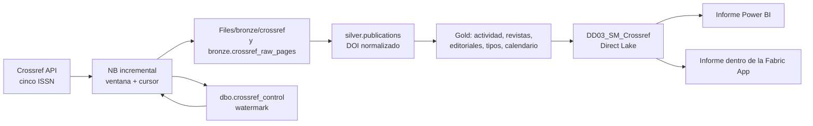
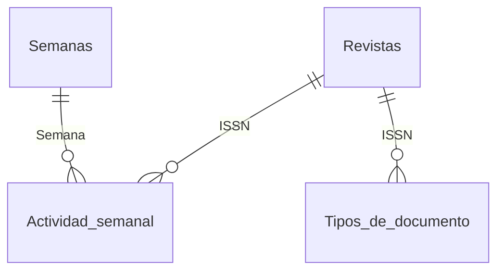

# Arquitectura del caso 03 · Crossref

La solución está en la carpeta `03-Crossref` del [workspace Data Days](https://app.fabric.microsoft.com/groups/0245bb51-e0d1-40f1-b071-fcbbf1d7b155/list). La [Fabric App](https://rural-unity-56e33da5da-spaincentral.webapp.fabricapps.net) presenta el caso y su informe; el [informe Power BI](https://app.fabric.microsoft.com/groups/0245bb51-e0d1-40f1-b071-fcbbf1d7b155/reports/039172b3-f877-437c-928e-37dd706d0968) ofrece la vista analítica completa.

## Movimiento del dato

| Tramo | Entrada | Salida | Comprobación |
| --- | --- | --- | --- |
| Fuente → Bronze | Páginas REST por revista y ventana temporal | JSON por `run_id` y tabla de páginas | Número de páginas y filas por ejecución |
| Bronze → Silver | Metadatos heterogéneos | Una publicación por DOI normalizado | Duplicados y campos esenciales controlados |
| Silver → Gold | Publicaciones normalizadas | Actividad semanal, resumen editorial, tipos, calidad y calendario | Cinco revistas dentro del alcance |
| Gold → análisis | Tablas Delta y `dbo.crossref_runs` | Modelo Direct Lake y dos interfaces de informe | Consulta DAX: **5 revistas y 3 editoriales** en la primera carga |

La canalización `DD03_PL_Crossref_Incremental` ejecutó correctamente una primera carga. `dbo.crossref_control` conserva el watermark para la siguiente ventana, con solapamiento de 24 horas. El observatorio cubre cinco revistas seleccionadas y sus resultados no representan todo Crossref.

## Modelo de análisis

Las tres relaciones son activas y de una dirección. `Editoriales` y `Ejecuciones` aportan resúmenes y auditoría sin unirse artificialmente a las revistas. La Fabric App y Power BI leen `DD03_SM_Crossref`; los materiales originales y las definiciones publicadas están en [`case-source/`](../case-source/) y [`fabric/`](../fabric/).

## Informe dentro de la Fabric App

La pestaña **Informe** consulta `DD03_SM_Crossref` con Rayfin y permisos delegados. Las consultas DAX están en [`packages/frontend/src/queries/report/`](../packages/frontend/src/queries/report/). El panel muestra DOI observados, cobertura ORCID, cobertura de resúmenes y estado de la última carga; representa publicaciones por revista y actividad de las doce semanas más recientes.

**Comprobación del 22-11-2026:** el DAX devolvió 25.693 publicaciones de cinco revistas, cobertura ORCID del 53,63 % y estado de carga «Correcta». El recuento cambia cuando se ejecuta otra carga; la app consulta siempre el modelo publicado.
